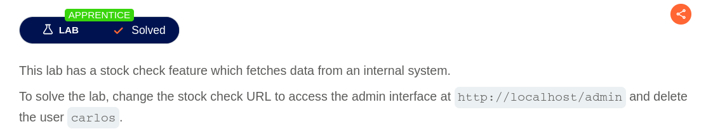

# Lab: Basic SSRF against the local server

## 1. Overview
It's a Portswigger's Academy lab. The SSRF vulnerability was found in the `stockApi` parameter. The application server reads and accepts any URL put in the `stockApi` parameter.

## 2. Affected Assets

1. **Target**: Portswigger's Academy Lab: Basic SSRF against the local server
2. **Endpoint**: `/check stock`
3. **Parameter**: `stockApi`
4. **Vulnerability**: SSRF

## 3. Steps to Reproduce with POC

1. Access the Lab
 
2. Click on any item's `View Details` button

