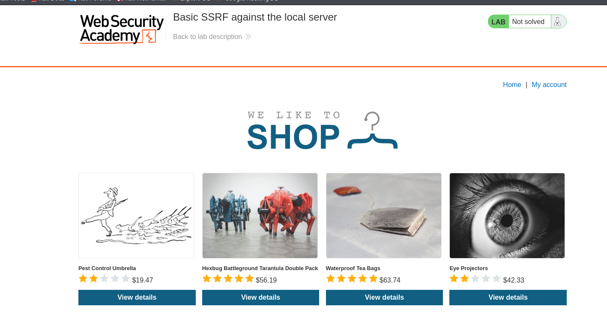
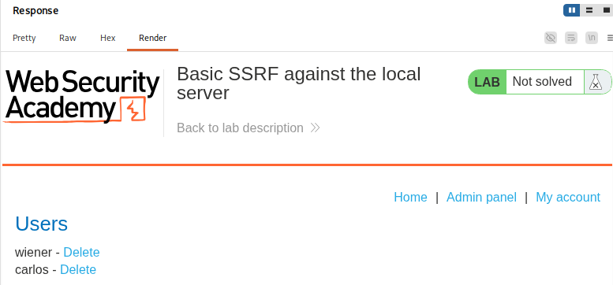

# Lab: Basic SSRF against the local server

## 1. Overview
It's a Portswigger's Academy lab. The SSRF vulnerability was found in the `stockApi` parameter. The application server reads and accepts any URL put in the `stockApi` parameter.

## 2. Affected Assets

1. **Target**: Portswigger's Academy Lab: Basic SSRF against the local server
2. **Endpoint**: `/check stock`
3. **Parameter**: `stockApi`
4. **Vulnerability**: SSRF

## 3. Steps to Reproduce with POC

1. Access the Lab

 
 
2. Click on any item's `View Details` button

3. Click on `Check Stock` button

4. Intercept the Request with burpsuite

5. Change the `stockApi` content to `http://localhost/admin/` (I have URL-Encoded it.)

6. Send the request and you'll be able to see the Admin page.

7. Click on `Delete` button in front of `carlos` and intercept the request.

8. Now we know the URL of Deleting the user `carlos` is: `http://localhost/admin/delete?username=carlos` .

Change the `stockApi` Parameter with this URL and send the request.

9. User `carlos` is successfully Deleted.

